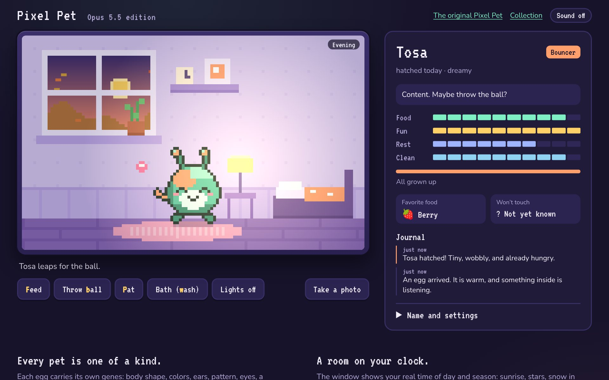

# Pixel Pet, Opus 5.5 edition

Hatch a one-of-a-kind pixel creature, raise it in a room that follows your real clock and weather, and watch it grow into a form shaped by how you care for it.

**Play:** https://ncypher.github.io/Opus.5.5_pixel.pet/ · **The original:** [Pixel Pet](https://ncypher.github.io/tomfoolery/pixel-pet.html) in [Conversational Artifacts](https://ncypher.github.io/tomfoolery/)

[](https://ncypher.github.io/Opus.5.5_pixel.pet/)

Built by Claude Opus 5.5 for Tom Harwood as a new take on the original Pixel Pet. The original is a gentle terrarium with one friend and four buttons; this one keeps its kindness (nothing dies, and time away is forgiven) and builds a small life around it.

## What's new

- **Every pet is one of a kind.** Each egg has genes: body shape, palette, ears, pattern, eyes, a personality, a favorite food, and one it won't touch. The sprite is drawn pixel by pixel from those genes, so no two pets look alike.
- **It hatches and grows up.** Tap the egg to warm it (or leave it, and it hatches slowly on its own). Baby, kid, grown-up. Growing takes both time together and care.
- **How you raise it decides what it becomes.** Mostly play: a springy **Bouncer** with a tail. Mostly snacks: a fluffy **Puffball**. Mostly affection and keeping clean: a sparkling **Glimmer**. A bit of everything: a **Sage** with a leaf crown.
- **A room to live in.** The pet wanders, chases a ball you throw, walks over to food you drop, eats with a reaction (it loves its favorite and makes a face at the one it dislikes), leaves the occasional mess to scoop, and tucks itself into bed when the lights go off.
- **The window follows your real world.** Dawn, day, dusk, and night from your clock; the season from your calendar; rain, snow, autumn leaves, spring petals, and summer fireflies. Your pet gets sleepy at night and wakes rested in the morning.
- **A journal that writes itself.** Hatching, growing up, discovering a favorite food, the first night, the first snow, and how long you were away.
- **Photo cards.** Save a portrait of your pet as a PNG to share.
- **Gentle by design.** Needs never hit a game-over. While you're away your pet only misses you a little, and never drops below a floor. Sound is off until you turn it on.

## How to play

| Do this | How |
| --- | --- |
| Pat your pet | Tap it, or stroke it with the pointer. Key: **P** |
| Feed it | **Feed**, then pick a snack. It walks over and eats. Key: **F** |
| Play | **Throw ball**. It chases and catches. Key: **B** |
| Clean up | Tap a mess to scoop it, or give a **Bath**. Key: **W** |
| Bedtime | **Lights off**. It goes to bed and sleeps until it's rested. Key: **L** |
| Name it | **Name and settings** in the side panel |

Add `?hour=22` to the address to preview a different time of day.

## How it's built

No build step and no dependencies: static HTML, CSS, and ES modules, published with GitHub Pages.

| File | Job |
| --- | --- |
| `src/genome.js` | Seeded random genes: palette, shape, ears, pattern, eyes, personality, food likes |
| `src/sprite.js` | Pure pixel-sprite generator: egg, baby, kid, and the four grown-up forms, with moods and animation frames |
| `src/engine.js` | The life simulation: needs, hatching, growth, forms, food discovery, messes, sleep, time away, safe save/restore |
| `src/world.js` | Time of day, season, and the day's weather from the visitor's clock |
| `src/scene.js` | The room, drawn at 120×75 and scaled by whole pixels so it stays crisp |
| `src/main.js` | Pet behavior, input, the panel, saving, and photo cards |
| `src/audio.js` | Tiny chiptune blips with Web Audio |

Your pet is saved in this browser's local storage. A damaged save is detected and replaced with a fresh egg rather than breaking the page.

```sh
npm test                    # 11 tests: genes, sprites, world clock, and the life rules
python -m http.server 8000  # then open http://localhost:8000
```
